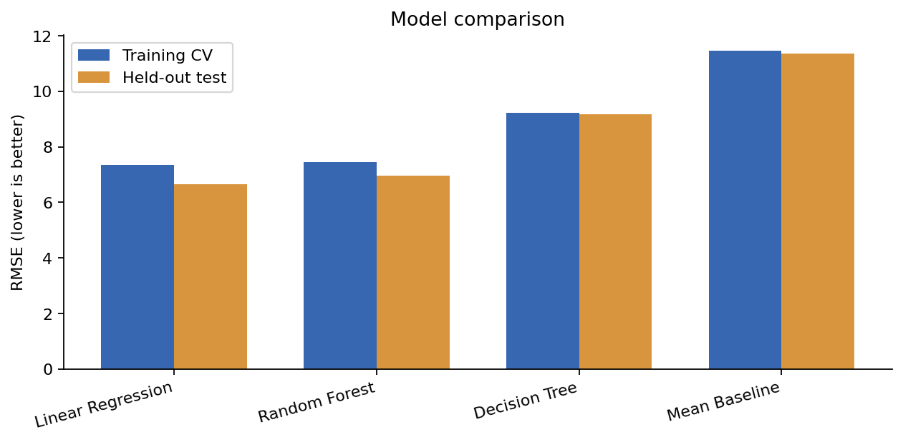
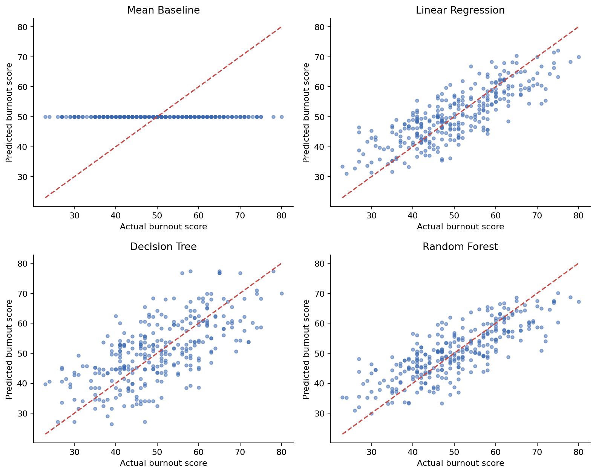
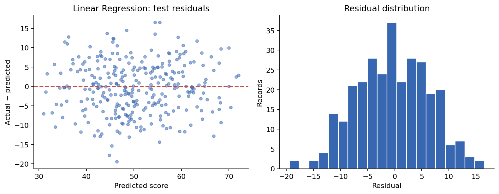
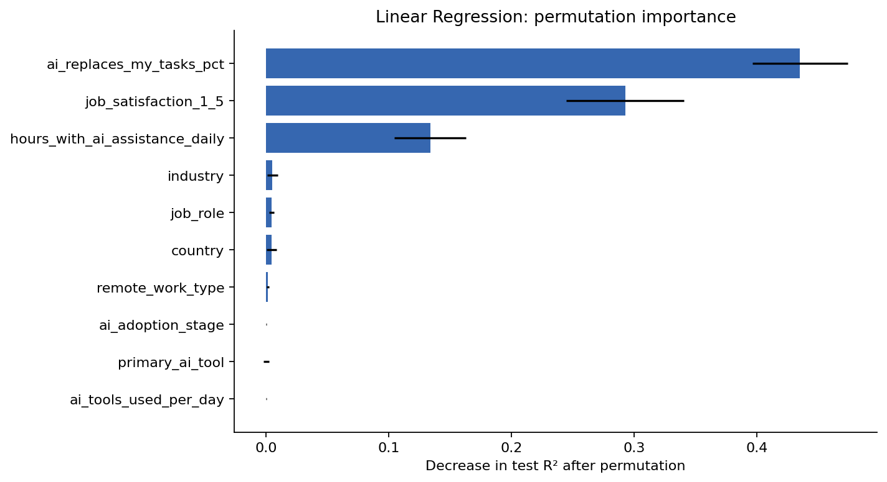

# AI Worker Burnout Prediction

A reproducible regression study comparing workplace and AI-related variables as predictors of `burnout_score`. Built with Python, pandas, and scikit-learn.

**Linear Regression was selected by training-only cross-validation**, achieving held-out test MAE **5.419**, RMSE **6.665**, and R² **0.655** in the corrected experiment. These are dataset-specific results, not evidence that AI causes burnout or that the model generalizes to real workers.



## Objective

Compare Linear Regression, Decision Tree, and Random Forest against a mean-prediction baseline. Understand prediction errors and whether additional model complexity improves performance.

The task is continuous-score regression, not burnout classification. R² is not classification accuracy.

## Dataset

| Field | Details |
|---|---|
| Title | AI Worker Burnout and Attrition Risk Dataset |
| Original listing | [Kaggle](https://www.kaggle.com/datasets/nudratabbas/ai-worker-burnout-and-attrition-risk-dataset) |
| Attributed creator/uploader | Nudrat Abbas (`nudratabbas`), attributed by a secondary source |
| File | `ai_worker_burnout_attrition_2026.csv` |
| Size | 1,500 records, 21 columns; all 1,500 retained |
| Target | `burnout_score` |
| License | Unverified |
| Provenance | Observed versus synthetic status unverified |

The original Kaggle listing returned 404 when checked on October 14, 2026. [This secondary article](https://medium.com/@himariaugm/burnout-pekerja-di-era-ai-analisis-attrition-risk-menggunakan-logistic-regression-399b9be31388) attributes the dataset to Abbas and provides the URL. Neither publication date nor data generation procedure was independently verified. The year in the filename is not treated as a collection date.

See [data/README.md](data/README.md) for provenance, availability, and reuse notes. The raw file already existed in this repository; this update does not establish redistribution rights or assign it a license.

## Evaluation Method

1. Strip categorical whitespace, normalize blank strings, remove exact duplicate records, and drop nonfinite/missing targets. Conflicting employee IDs raise an error rather than being silently discarded.
2. Retain extreme observations. No target-based filtering or data-derived IQR thresholds are used.
3. Exclude `employee_id`, the target, and `attrition_risk`. The construction of `attrition_risk` is unknown; exclusion is a precaution against possible outcome-derived leakage, not proof that leakage occurs.
4. Split raw features into **1,200 training / 300 test records**, using `random_state=42`.
5. Fit median numerical imputation, standard scaling, categorical mode imputation, and one-hot encoding inside each model's `Pipeline`. One category is dropped per field to avoid redundant dummy columns; unseen categories are handled without fitting on test data.
6. Compare models using a shared **five-fold shuffled KFold on the training split only**, with seed 42. All three metrics are calculated in one `cross_validate` call per model.
7. Select the model with the lowest mean CV RMSE, then fit on the full training split. Report test metrics for all models without selecting or tuning on test performance.
8. Inspect prediction plots, residuals, and permutation importance of the CV-selected model. Importance is descriptive; it is not used to change the model after viewing the test set.

Tree settings retain the original experiment's depth, leaf-size, and forest-size choices. No hyperparameter search was added. All categorical predictors, including potentially ordinal fields, are one-hot encoded because a validated ordering/data dictionary is unavailable. Numerical scaling is applied consistently across pipelines, although trees do not require it.

This pipeline follows [scikit-learn's guidance on data leakage](https://scikit-learn.org/stable/common_pitfalls.html#data-leakage).

## Corrected Results

| Model | Training CV RMSE | Training CV R² | Test MAE | Test RMSE | Test R² |
|---|---:|---:|---:|---:|---:|
| Linear Regression | 7.361 ± 0.337 | 0.585 | 5.419 | 6.665 | 0.655 |
| Random Forest | 7.463 ± 0.374 | 0.573 | 5.609 | 6.968 | 0.623 |
| Decision Tree | 9.231 ± 0.311 | 0.347 | 7.622 | 9.170 | 0.347 |
| Mean Baseline | 11.458 ± 0.371 | -0.004 | 9.263 | 11.352 | -0.000 |

CV RMSE is the mean ± sample standard deviation across five training folds; this spread is not a confidence interval. Lower MAE/RMSE is better. Higher R² is better.

- Linear Regression had the lowest training-CV RMSE and the best recorded test metrics.
- Random Forest did not outperform the selected linear model in this experiment.
- Decision Tree training R² was 0.823, compared with test R² 0.347, indicating overfitting.
- The mean baseline had test RMSE 11.352, versus 6.665 for Linear Regression.

The old notebook reported Linear Regression test R² 0.629. It used full-data preprocessing, label encoding, target-inclusive outlier removal, a different retained sample, and an outcome-like predictor. The new results replace those figures; the change cannot be attributed to any single correction.

Full precision metrics and single-machine fit/prediction timings are in [reports/model_metrics.csv](reports/model_metrics.csv). Timings are indicative, not portable benchmarks. [reports/experiment.json](reports/experiment.json) records dependencies, dataset SHA-256, split fingerprint, feature list, and cleaning audit.

## Visualizations







Permutation importance measures the decrease in test R² when an original feature is shuffled (10 repeats, seed 42). Correlated predictors can share importance; a high value does not demonstrate causality. Error bars show the standard deviation across repeats.

Training-split target distribution and numeric correlations are also available in `reports/figures/`.

## Run Locally

Use **Python 3.12** to match the published environment.

```bash
python -m venv .venv
# Windows: .venv\Scripts\activate
# macOS/Linux: source .venv/bin/activate
pip install -r requirements.txt
python code.py
```

The default dataset path is resolved relative to `code.py`, so the script also works when called from another working directory. To use another local copy:

```bash
python code.py --data /path/to/ai_worker_burnout_attrition_2026.csv --output-dir reports
```

To use the notebook:

```bash
pip install -r requirements-notebook.txt
jupyter lab notebook.ipynb
```

Restart the kernel and run all cells. The notebook imports the same functions as the CLI, preventing drift between two independent implementations. It creates its own outputs in `reports/scratch/notebook/`, leaving committed results unchanged.

## Repository Files

| Path | Purpose |
|---|---|
| `code.py` | Data checks, train-only preprocessing, CV selection, evaluation, plots, CLI |
| `notebook.ipynb` | Executed walkthrough of the corrected experiment |
| `requirements.txt` | Exact core dependency versions used for the experiment |
| `requirements-notebook.txt` | Optional notebook tooling |
| `data/README.md` | Dataset attribution and availability notes |
| `reports/model_metrics.csv` | Training, CV, and test metrics plus timings |
| `reports/experiment.json` | Reproducibility metadata and data audit |
| `reports/feature_importance.csv` | Original-feature permutation importance |
| `reports/figures/` | Exported diagnostic figures |
| `tests/test_pipeline.py` | Checks for inference-time preprocessing stability, missing/unseen categories, retained extremes, and conflicting IDs |

Run the regression checks with:

```bash
python -m unittest discover -s tests -v
```

## Validation

- CLI experiment completed on Python 3.12.14 with the pinned core dependencies.
- All eight notebook code cells ran sequentially in a fresh IPython process and matched the CLI's dataset/split fingerprints and every non-timing metric.
- Notebook format validated with `nbformat`.
- Three regression checks passed (`python -m unittest discover -s tests -v`).
- Diagnostic figures were exported and checked for layout.

The environment blocks Jupyter's TCP and IPC sockets, so a separate Jupyter kernel could not start here. Notebook code was verified through fresh-process IPython execution; interactive Jupyter startup on a user's machine was not verified in this environment.

## Completed Improvements

- [x] Correct execution order; remove Colab-only uploads and unused model dependencies.
- [x] Fit preprocessing within training splits and CV folds.
- [x] Replace arbitrary category labels with one-hot encoding.
- [x] Retain extreme target/feature values instead of filtering them by IQR.
- [x] Review `attrition_risk` and exclude it conservatively.
- [x] Add `DummyRegressor` mean baseline.
- [x] Re-run the corrected experiment and export results.
- [x] Record source attribution, provenance uncertainties, and reproducibility metadata.

## Remaining Limitations and Next Steps

- **Unverified dataset provenance and license:** recover the original dataset card or creator confirmation. Real-world versus synthetic status, scoring definitions, data generation, publication date, and reuse terms remain unresolved.
- **Concurrent predictors:** `job_satisfaction_1_5` and `productivity_score` are retained for an exploratory, same-record prediction task. Their measurement timing and potential dependence on burnout are unknown. Before claiming prospective prediction, obtain definitions and run a pre-specified sensitivity experiment without these fields using a new evaluation protocol.
- **One dataset and one random holdout:** the test split was previously explored in the original project, so the revised results are not an untouched external validation. Confirm performance on independent data before deployment claims.
- **No temporal, employer-group, or external validation:** employee IDs are unique, but the dataset does not establish independent sampling or provide a suitable employer/time grouping scheme.
- **Fixed model configurations:** no exhaustive search, uncertainty intervals, subgroup robustness assessment, or production inference interface is included.
- **No causal interpretation:** predictive associations and feature importance do not show that AI use causes burnout. Burnout-scale clinical validity is unverified.

## Author

Dylan Wilson  
Informatics undergraduate, Universitas Multimedia Nusantara
